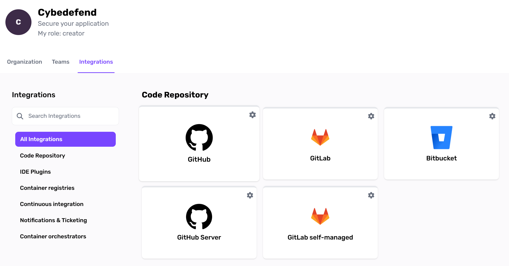

To begin performing **static code scans** on your GitHub repositories with CybeDefend, you’ll need to **authorize** and **install** our GitHub App. Once installed, your repositories will be accessible when creating new projects in CybeDefend.

<Frame>
  
</Frame>

---

## 1. Access Organization Integrations

1. **Navigate to “Integratin Settings”** 
   Go to your Organization's settings > Integrations.
2. **Search for “GitHub”** 
   Within that section, choose the **GitHub** option for installation instructions.
3. **Click “Install & Authorize”**  
   You’ll be redirected to GitHub’s official authorization flow.

<Note>
You must have <strong>Administrator or Manager privileges</strong> in CybeDefend to add integrations.
</Note>

Start the installation from this page. CybeDefend issues a single-use token for
the flow, valid **10 minutes**, and GitHub hands it back when it redirects you
to CybeDefend. An installation URL you saved, or one someone sent you, does not
carry a valid token: if the callback answers *"Invalid or expired installation
state. Please restart the GitHub installation from the dashboard."*, click
**Install & Authorize** again here.

---

## 2. Install & Authorize CybeDefend on GitHub

When GitHub prompts you to install the **CybeDefend GitHub App**:

1. **Choose Repositories**  
   Select either all or specific repositories to grant CybeDefend read access.  
2. **Confirm Permissions**  
   We need at least read access for scanning. Write access is optional but enables advanced features like **Auto-Fix PRs** (coming soon).
3. **Complete Installation**  
   Wait a few seconds for GitHub to finalize authorization.

<Tip>
If you have organizational policies restricting third-party app installations, contact your GitHub Org Admin to approve CybeDefend’s GitHub App.
</Tip>

<Note>
An installation of the CybeDefend GitHub App made **more than 15 minutes** ago —
one a colleague set up, or one you installed for another purpose — is connected
to a CybeDefend organization only by someone who administers it on the GitHub
side:

| The App is installed on | Who can connect it |
|-------------------------|--------------------|
| A personal account | That account itself |
| A GitHub organization | An active owner of the organization, or an administrator of every repository the installation covers |

Anyone else gets *"An administrator of the GitHub account must connect this
installation."* An installation you create in the flow above needs nothing more.
</Note>

---

## 3. Linking Repositories to Your Projects

After installation, you can associate any authorized repository with a **new project** in CybeDefend:

- **Go to "Create Project"**: Navigate to [Create Project](/latest/get-started/project-management/create-project).  
- **Select "Continue with GitHub"**: Your authorized repos will appear in a dropdown.  
- **Choose Your Repo**: Pick a repository, assign it to a team, and configure scanning parameters.

<Note>
If you just installed the app, it may take a few moments before your repositories become visible in the "Create Project" flow.
</Note>

---

## Calling the Install Callback Yourself

<Warning>
`POST /organization/{organizationId}/github/install/callback` requires a
`state` field. Issue one with
`POST /organization/{organizationId}/github/install/state`, which returns a
single-use, 64-character hexadecimal token valid 10 minutes and needs the
`manage_integration` permission on the organization. Add it to the GitHub App
installation URL as the `state` query parameter so GitHub returns it to your
callback page, then pass it back in the body. A body without it, or with a
token already used, issued for another organization or issued for another user,
is rejected with `400`.

Before:

```json
{ "code": "f1a2b3...", "installationId": 123456 }
```

After:

```json
{
  "code": "f1a2b3...",
  "installationId": 123456,
  "state": "a1b2c3d4e5f6a1b2c3d4e5f6a1b2c3d4e5f6a1b2c3d4e5f6a1b2c3d4e5f6a1b2"
}
```
</Warning>

---

**Related:** [Connect GitLab](/latest/get-started/connect-your-source-code/connect-gitlab) · [Create a Project](/latest/get-started/project-management/create-project) · [Cybe AutoFix](/latest/agent-ai-integration/cybe-autofix-detail)
